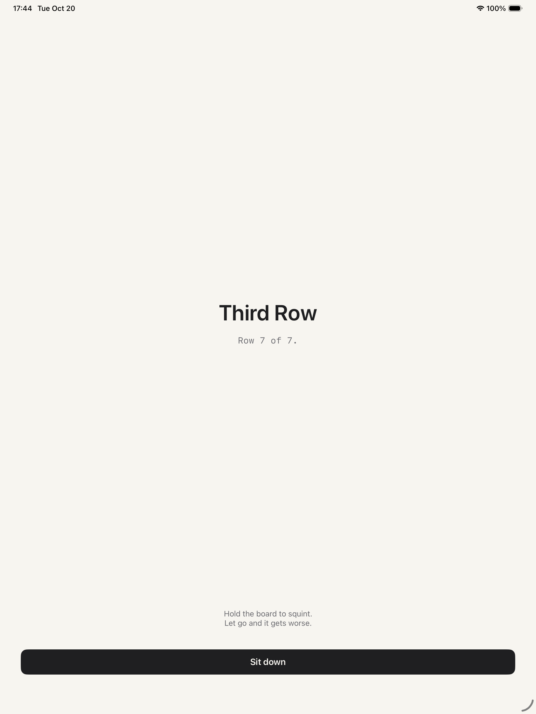
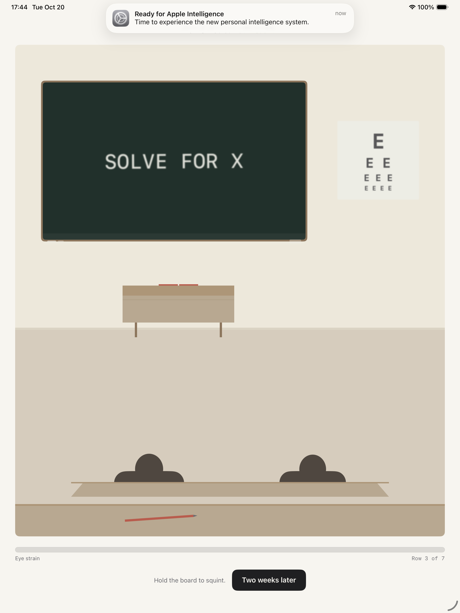
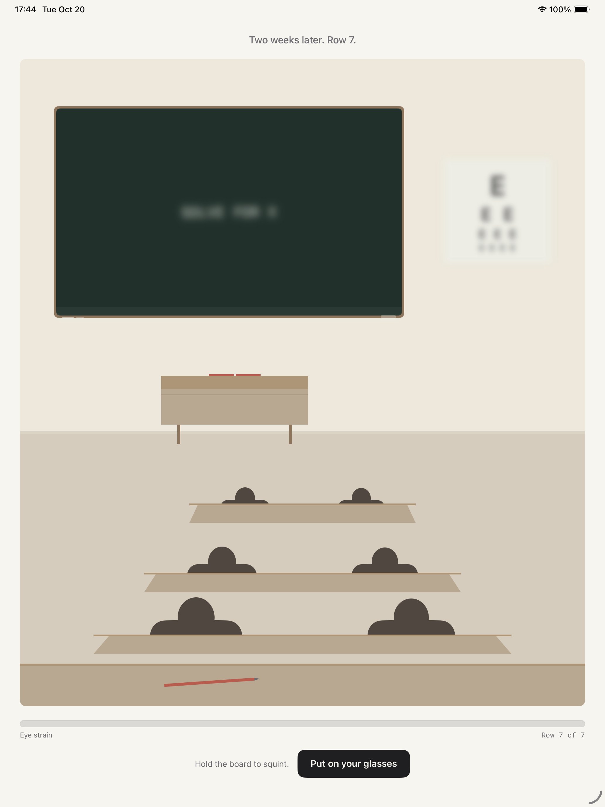

# Third Row

An app playground for the Swift Student Challenge 2027.

## The idea

My classroom has seven rows. I sit in the last one.

In row 3 I could read the board. Two weeks later, in row 5, the same equation took me the whole lesson to decipher. By row 7 I was squinting as hard as I could, and it stopped helping. So I asked the boy next to me to read it out loud, and I copied down an answer I had no way to check.

That is the piece: not the blur itself, but the workaround. Squinting works for a while, and it costs more than it gives.

## Interaction

Three minutes, four scenes:

1. **Row 3** — hold the board to squint. It helps.
2. **Row 5** — it helps less, and the strain bar no longer returns to zero.
3. **Row 7** — squinting gives almost nothing. The only way forward is to ask someone.
4. **Copy** — he reads the answer out loud and you write it down with a pencil. The board stays blurred, so there is no way to check what you copied.
5. **Glasses** — the blur is taken away in under a second.
6. **Recap** — the number of seconds you spent squinting, and two facts about my class.

## Sound

Every sound is synthesised at launch from a few lines of maths in `SoundSynth.swift`:
chalk on a board, low pressure while squinting, a metal chime when the glasses arrive,
and a soft hit when two weeks pass. Nothing is bundled, nothing is downloaded, and the
package grows by zero bytes.

The speaker icon in the strain row mutes it.

## Screens

Captured automatically on every build (see `docs/screens/`).

| | |
|---|---|
|  |  |
|  |  |
|  |  |

## Structure

```
ThirdRow.swiftpm/
  Package.swift            Swift Playgrounds app manifest
  ThirdRowApp.swift        entry point
  Core/Models/             EyeState (mechanic), Act (per-row config)
  Views/                   RootView, IntroView, StageView, CopyView, PencilCanvas,
                           ClassroomScene, RevealView, RecapView, StrainBar
  Utilities/               AppTheme, ChalkText, SoundSynth, SoundPlayer
```

## Two rules in the classroom

`ClassroomScene` is a first-person view from the seat. Two things must stay true when editing it:

- **The number of desk rows between you and the board grows with the act** (row 3 → one row of heads in front, row 7 → three). The seat change is shown, never narrated.
- **Only the far layer is blurred** — the board, the eye chart, the timetable. Myopia is a distance problem: the desks in front of you stay sharp. Blurring the whole screen would just be a filter.

A third rule, added after the first version: nothing floats. The floor line, the skirting
board and the teacher's desk legs all agree on where the ground is.

## Squinting has diminishing returns

`Act.squintGain` scales how much relief a hold gives: 1.0 in row 3, 0.72 in row 5, 0.38 in
row 7. It is a mechanic, not a difficulty curve. Squinting is a workaround, and workarounds
stop working.

## Running it

Open `ThirdRow.swiftpm` in Swift Playgrounds 4.6 or Xcode 26. No network access is required
and there are no external dependencies. iOS 17 or later.

## Credits

All visuals are drawn in code. Every sound is generated in code. No third-party assets.

## AI disclosure

See `AI_USAGE.md`.
