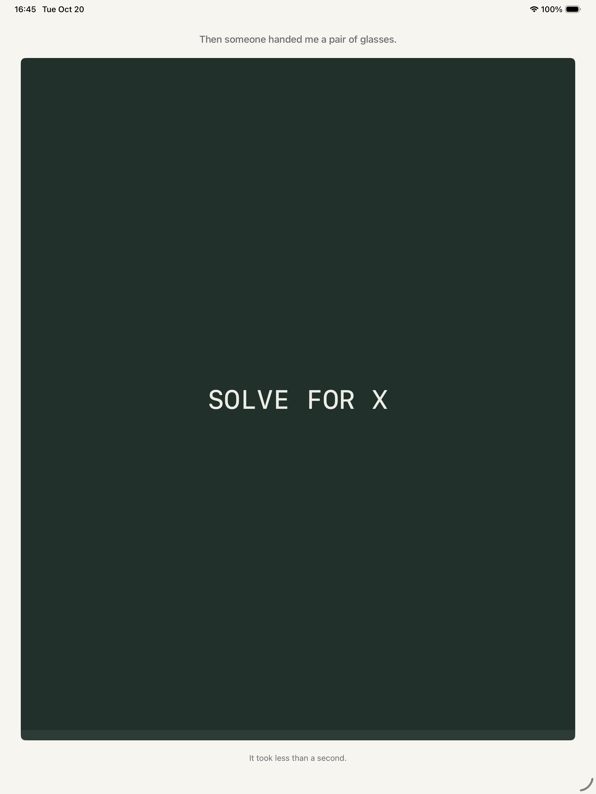

# Third Row

An app playground for the Swift Student Challenge 2027.

## The idea

My classroom has seven rows. I sit in the last one.

The board goes blurry long before anyone asks whether you can see it. Holding the screen is squinting: it makes the words readable for a moment, and it costs you. Let go, and everything is worse than before, because the recovery is deliberately slower than the damage.

Three seats. Two weeks apart. Then a pair of glasses arrives, and the blur is taken away in under a second.

## Interaction

- Press and hold the blackboard to squint.
- Watch the strain bar. It never goes back down as fast as it went up.
- Three rows. Then a pair of glasses, and a recap with the number of seconds you spent squinting.

## Screens

Captured automatically on every build (see `docs/screens/`).

| | |
|---|---|
|  |  |
|  |  |

## Structure

```
ThirdRow.swiftpm/
  Package.swift          Swift Playgrounds app manifest
  ThirdRowApp.swift      entry point
  Core/Models/           EyeState (mechanic), Act (three-stage config)
  Views/                 RootView, IntroView, StageView, ClassroomScene, RevealView, RecapView, StrainBar
  Utilities/AppTheme.swift
```

## Why the room is drawn, not decorated

`ClassroomScene` is a first-person view from the seat. Two rules:

- The number of desk rows between you and the board grows with the act (row 3 → one row of heads in front, row 7 → three). The seat change is shown, not narrated.
- **Only the board is blurred.** Myopia is a distance problem: the desks in front of you stay sharp while the far layer goes soft. Blurring the whole screen would just be a filter.

## Running it

Open `ThirdRow.swiftpm` in Swift Playgrounds 4.6 or Xcode 26. No network access is required; there are no external dependencies.

## Credits

All visuals are drawn in code. No third-party assets are used.

## AI disclosure

See `AI_USAGE.md`.
